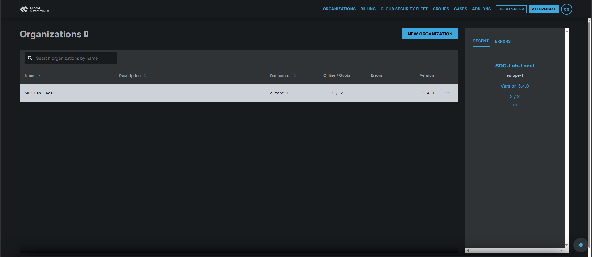
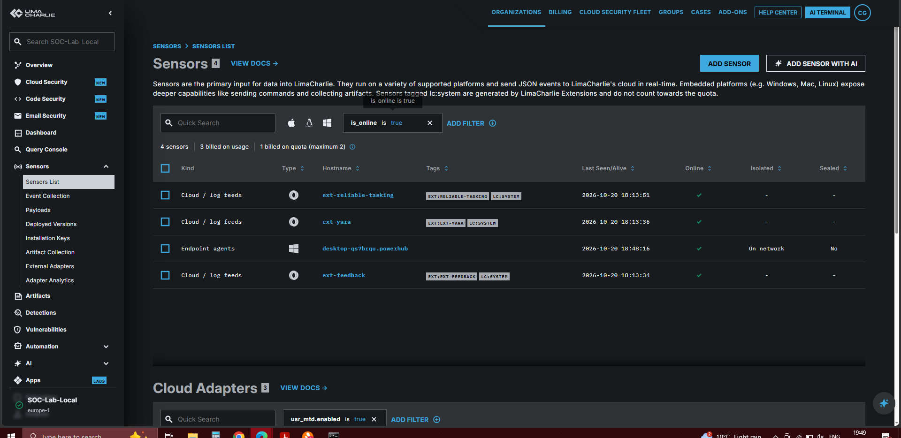
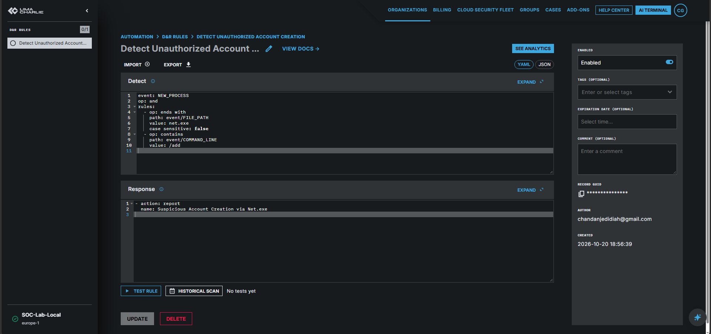
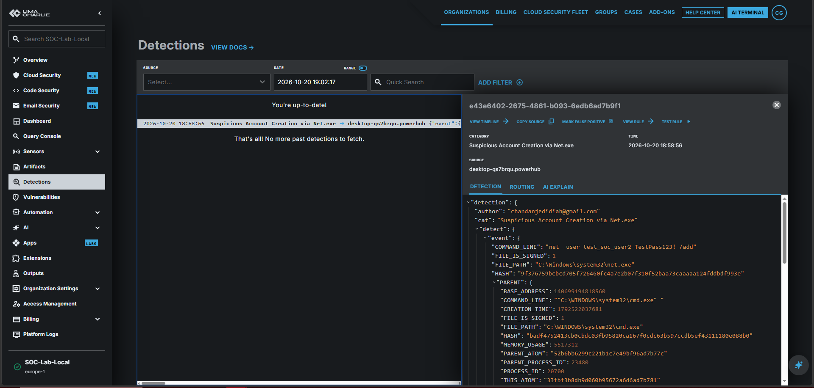

# Local Endpoint Detection & Response (EDR) Threat Lab

## Project Overview
In this lab, I deployed a cloud-managed Endpoint Detection & Response (EDR) agent on a Windows host using **LimaCharlie** to gain hands-on experience with telemetry collection, detection engineering, and incident triage. I executed simulated persistence tactics mapped to the **MITRE ATT&CK Framework**, authored multi-condition YAML detection rules, and analyzed live process execution trees to confirm alert legitimacy.

---

## Technical Architecture & Telemetry Pipeline
```text
Windows Host (Local Machine)
   └── LimaCharlie Sensor Agent (HCP)
          └── Cloud Pipeline Telemetry Ingestion
                 └── Rule Detection Engine (YAML Rules)
                        └── Real-Time Incident Triage & Alerts
```

---

## Threat Simulations Executed (MITRE ATT&CK Mapping)
- **Persistence / Local Account Creation ([MITRE T1136.001](https://attack.mitre.org/techniques/T1136/001/)):** Simulated an attacker establishing local backdoor access by executing administrative account additions via CLI (`net.exe user /add`).
- **Privilege Escalation ([MITRE T1078](https://attack.mitre.org/techniques/T1078/)):** Escalated permissions by adding the test entity directly into the local `Administrators` group (`net localgroup Administrators /add`).
- **Obfuscated / Encoded Command Execution ([MITRE T1027](https://attack.mitre.org/techniques/T1027/)):** Executed encoded PowerShell command strings to test agent visibility against evasion techniques.

---

## Custom Detection & Response (D&R) Rule Definition

```yaml
event: NEW_PROCESS
op: and
rules:
  - op: ends with
    path: event/FILE_PATH
    value: net.exe
    case sensitive: false
  - op: contains
    path: event/COMMAND_LINE
    value: /add
```

### Response Action:
```yaml
- action: report
  name: Suspicious Account Creation via Net.exe
```

---

## Rule Tuning & Engineering Lessons
- **Noise Reduction & False Positive Tuning:** Alerting strictly on `net.exe` executions creates excessive noise from routine sysadmin activity (`net.exe use`, `net.exe start`). Requiring both `net.exe` in the file path and `/add` in the command-line arguments narrowed the detection specifically to account creation events.
- **Path Matching Logic:** Used `ends with` for `FILE_PATH` combined with `case sensitive: false` to ensure detection regardless of execution path aliases (e.g. `C:\Windows\System32\net.exe` vs relative path execution).
- **Evasion Awareness / Defense-in-Depth:** In a production SOC environment, attackers can bypass `net.exe` detections by using `net1.exe` or native PowerShell cmdlets (`New-LocalUser`). A natural next step for rule coverage would be expanding telemetry logic to monitor `net1.exe` and SAM registry modifications.

---

## Incident Triage & Analyst Workflow
1. **Alert Trigger:** The D&R rule engine flagged a `NEW_PROCESS` event matching `net.exe` with command line arguments containing `/add`.
2. **Telemetry Investigation:** Inspected the process execution tree in LimaCharlie to review parent-child relationships. Verified that `cmd.exe` spawned `net.exe` under elevated privileges.
3. **Contextual Analysis:** Checked process hash, user context, and host activity to distinguish between legitimate administrative maintenance and simulated attacker behavior.
4. **Containment & Remediation:** Manually purged unauthorized test accounts via CLI (`net user test_soc_user2 /delete`) and confirmed host telemetry returned to a clean baseline.

---

## Lab Evidence & Screenshots

### Phase 1: LimaCharlie Cloud Infrastructure Setup


### Phase 2: Active EDR Agent Sensor Connection


### Phase 3: Detection & Response (D&R) Rule Configuration


### Phase 4: Telemetry Alert & Process Execution Tree Triage

